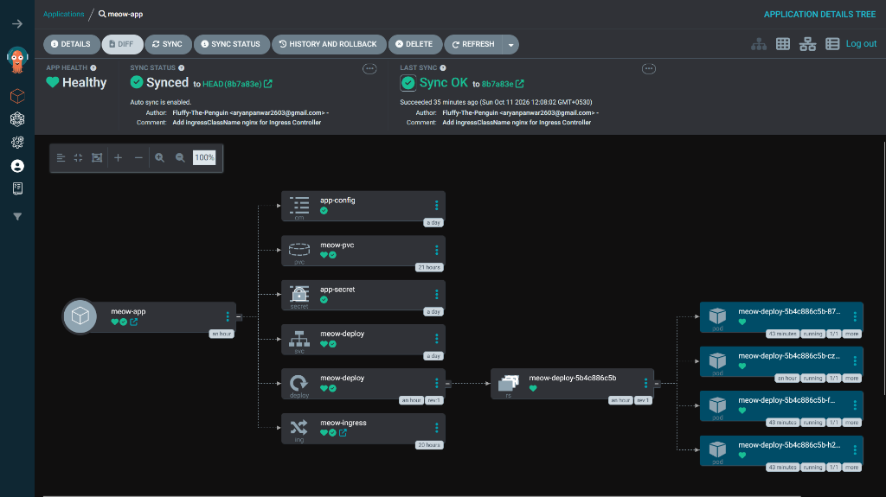

# Production Node.js Microservice — Docker, Kubernetes, DevSecOps CI & ArgoCD GitOps

End-to-end containerized Node.js microservice orchestrated on **Kubernetes** with zero-downtime rolling updates, automated **GitHub Actions + Trivy DevSecOps** container builds, and **ArgoCD GitOps** continuous delivery.

---

## Live ArgoCD GitOps Deployment (`Synced` & `Healthy`)

---

## Architecture & Production Features

### 1. Containerization (`Dockerfile`, `.dockerignore`, `compose.yaml`)
* **Layer-Cached Build:** Splits `COPY *.json .` and `RUN npm install` before copying application source code (`server.js`) for instant `0.0s` cached rebuilds.
* **Non-Root Security Hardening:** Runs under least-privilege `USER node` (`UID 1000`) with a strict `.dockerignore` excluding local `node_modules`, `.git`, and `.env`.
* **Multi-Container Local Stack (`compose.yaml`):** Orchestrates the Node.js API alongside a persistent `redis:alpine` cache backed by named Docker volumes (`redis-vault:/data`).

### 2. Kubernetes Production Manifest (`k8s.yaml`)
* **`Deployment` (`apps/v1`):**
  * **Zero-Downtime Strategy:** `RollingUpdate` with `maxSurge: 1` and `maxUnavailable: 0`.
  * **Self-Healing Probes:** Configured with both `livenessProbe` and `readinessProbe` (`httpGet` on `:3000/`).
  * **Resource Guardrails:** Enforces CPU (`100m` request / `250m` limit) and Memory (`64Mi` request / `128Mi` limit) quotas.
* **`Service` (`v1`):** Exposes stable cluster networking and load balancing across Pod endpoints.
* **`ConfigMap` & `Secret` (`v1`):** Injects non-sensitive environment configuration and Base64-encoded secrets via `envFrom`.
* **`PersistentVolumeClaim` (`v1`):** Provisions `1Gi` `ReadWriteOnce` persistent storage mounted into Pods at `/data`.
* **`Ingress` (`networking.k8s.io/v1`):** Layer 7 NGINX Ingress (`ingressClassName: nginx`) routing `meow.local/` traffic to the internal Service.

### 3. DevSecOps CI/CD & GitOps (`.github/workflows/ci.yml` & `argocd-app.yaml`)
* **Continuous Integration (`GitHub Actions`):** Automatically checks syntax (`node --check`), builds the Docker image with sequential version tags (`:v${{ github.run_number }}`), scans for `CRITICAL` vulnerabilities with **Aqua Security Trivy**, and pushes to Docker Hub.
* **Continuous Delivery (`ArgoCD`):** Declarative `kind: Application` (`argocd-app.yaml`) continuously reconciles cluster state against `main` with `automated` sync, `prune: true`, and `selfHeal: true`.
